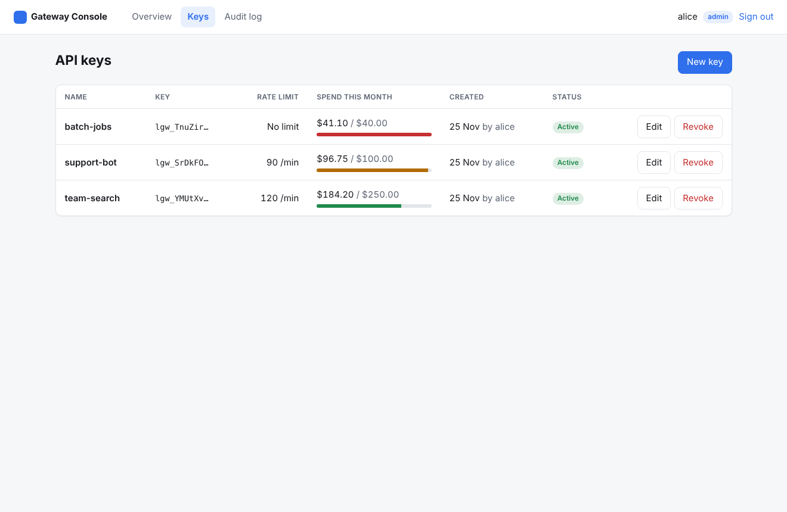
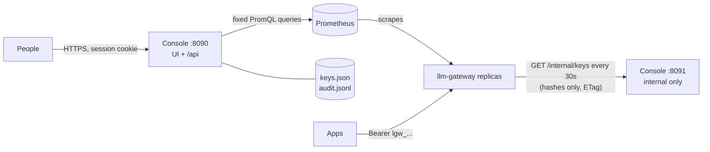

# llm-gateway-console

[](https://github.com/sillykea/llm-gateway-console/actions/workflows/ci.yml)

A web console for [llm-gateway](https://github.com/sillykea/llm-gateway): teams get their own API keys with rate limits and monthly budgets, admins create and revoke them without touching config, and everyone can see what the gateway is spending and how it is behaving.

Go API (standard library only) + React and TypeScript UI, embedded in one binary.


## Try it in 2 minutes

Needs Docker. Everything runs on your machine with fake models: no API keys, no GPU, no cloud account.

```sh
git clone https://github.com/sillykea/llm-gateway-console.git
cd llm-gateway-console
make demo
```

Open http://localhost:8090 and sign in as `admin` / `demo-admin-password` (or `viewer` / `demo-viewer-password`).

The demo runs the console, [llm-gateway](https://github.com/sillykea/llm-gateway) built from its `v1.0.0` release, Redis, Prometheus, two mock models and a traffic generator. The generator creates a key for three teams through the console's API, then sends a few requests a second through the gateway. Within a minute you'll see:

- **Spend per team**, counting up against each budget. `batch-jobs` runs out after a few minutes and starts getting `429`s.
- **Cache hits** from repeated questions.
- **Failovers:** the "cloud" mock fails 8% of requests, and the gateway retries them on the "local" one.
- **Personal data kept local:** requests containing an email address only ever reach the local model.

Create or revoke a key in the UI and the gateway follows within 5 seconds. `make demo-logs` shows the traffic, `make demo-down` stops everything, and `make demo-reset` also deletes the demo's keys. CI boots this same demo on every push and checks the numbers come through.

## What it does

- **Overview.** Spend this month, requests, error rate, cache hit rate, failovers and p95 latency, spend per key and requests per model, with a warning when a provider's circuit breaker is open. Read from Prometheus, so the numbers cover every gateway replica and survive restarts.
- **API keys.** Admins create a key per team or service with a rate limit and a monthly budget. The key is shown once; the console keeps only its SHA-256 hash. Spend is shown against each key's budget, and keys can be edited or revoked.
- **Gateway sync.** Gateways pull the active key hashes every 30 seconds. A new key works, and a revoked key stops working, without a config change or restart.
- **Roles and audit.** Viewers see everything except the audit log; admins can change keys. Every sign-in, failed sign-in and key change is in an append-only audit log.



## How it fits together



- The public port (8090) serves people. The key list for gateways is on a separate internal port (8091) with its own token, so an ingress mistake can't expose it.
- Gateways **pull**; the console never needs access to them. If the console is down, gateways keep the last key list they had ([gateway ADR 6](https://github.com/sillykea/llm-gateway/blob/main/docs/adr/0006-keys-from-the-console.md)).
- Only hashes leave the console. Keys are 256 bits of randomness, so a hash can't be turned back into a key.

## Quick start

Needs Go 1.24+ and Node 22+.

```sh
make build                          # builds the React app, then the Go binary with it embedded
bin/console hash-password           # prints a password hash
cp users.example.json users.json    # paste hashes in for your admin and viewer
make dev                            # http://localhost:8090, metrics from PROMETHEUS_URL
```

Point a gateway at it:

```json
"key_source": {
  "url": "http://console:8091/internal/keys",
  "token_env": "CONSOLE_SYNC_TOKEN",
  "refresh_seconds": 30
}
```

## Configuration

| Variable | Default | |
|---|---|---|
| `CONSOLE_LISTEN` | `:8090` | UI and API for people |
| `CONSOLE_INTERNAL_LISTEN` | `:8091` | `/internal/keys` for gateways; keep it off the ingress |
| `CONSOLE_DATA_DIR` | `./data` | key records and the audit log (a persistent volume) |
| `CONSOLE_USERS_FILE` | `./users.json` | users and roles ([ADR 2](docs/adr/0002-users-from-a-file.md)) |
| `CONSOLE_SESSION_SECRET` | required | 32+ characters; signs session cookies |
| `CONSOLE_SYNC_TOKEN` | required | 32+ characters; shared with gateways |
| `PROMETHEUS_URL` | unset | Prometheus that scrapes the gateways; without it the overview is empty |
| `CONSOLE_INSECURE_COOKIES` | `false` | `true` only for `http://localhost` |

## Security

- **Keys:** 256-bit random, shown once, stored and synced as SHA-256 only. Names are never reused, so a new key can't inherit an old key's spend.
- **Sign-in:** PBKDF2-SHA256 with 600,000 iterations; 5 failures per 15 minutes per client and per username; the same response time for unknown users; every attempt audited.
- **Sessions:** HMAC-signed `__Host-` cookies, `HttpOnly`, `Secure`, `SameSite=Strict`, 8 hours ([ADR 3](docs/adr/0003-signed-session-cookies.md)).
- **CSRF:** state changes need a JSON body and are refused when `Origin` or `Sec-Fetch-Site` shows another site.
- **Browser:** strict CSP (only the app's own script and styles, no inline script, no framing), `nosniff`, no referrer.
- **API:** unknown JSON fields are rejected, bodies are capped at 16 KB, and only fixed PromQL queries are run; the browser can't send its own.
- **Container:** distroless, non-root, no shell.

## Testing

```sh
make test                                   # Go unit tests, with the race detector
GATEWAY_BIN=/path/to/gateway make e2e       # browser tests in headless Chromium
```

The browser tests run the real console binary against a fake Prometheus. They sign in as each role, check viewers can't change anything, then create, edit and revoke keys. With `GATEWAY_BIN` set, they also start a real llm-gateway, check it **accepts** a key made in the UI, and **rejects** it after it's revoked. CI runs all of it on every push, plus `staticcheck`, `govulncheck` and a strict TypeScript check.

## Design decisions

1. [A small dependency footprint](docs/adr/0001-small-dependency-footprint.md)
2. [Users come from a file, not a sign-up flow](docs/adr/0002-users-from-a-file.md)
3. [Stateless, signed session cookies](docs/adr/0003-signed-session-cookies.md)
4. [Keys and the audit log in files, for one replica](docs/adr/0004-file-store.md)

## Roadmap

- Sign-in with OIDC (company SSO), groups mapped to roles
- A live request feed from the gateways
- Postgres storage for more than one replica ([ADR 4](docs/adr/0004-file-store.md))
- A Helm chart and Argo CD app in [llm-gateway-platform](https://github.com/sillykea/llm-gateway-platform)

## License

[MIT](LICENSE)
